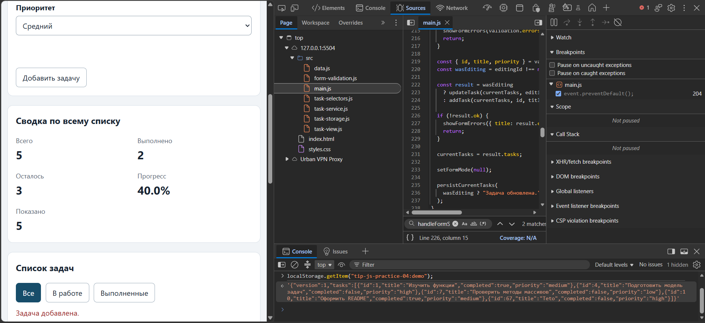

# Практическая работа № 4. Формы, валидация и локальное хранение данных

## Данные работы

| Поле | Значение |
|---|---|
| Имя | Соколов Александр Юрьевич |
| Группа | ЭФБО-06-25 |
| Вариант из ПР2–ПР3 | 2 |
| Node.js | v24.21.0 |
| Браузер | Microsoft Edge 154.0.4258.37 |
| Операционная система | Windows 11 |

## Запуск

Рабочая папка: `practice-04` внутри личного репозитория.

```bash
npm test
npm start
```

Устанавливать зависимости через `npm install` не требуется.

```text
http://127.0.0.1:5504/
http://127.0.0.1:5504/index.html?dataset=variant
http://127.0.0.1:5504/examples/forms-storage.html
http://127.0.0.1:5504/checks.html
```

## Перенос результата ПР3

Указать, какие модули перенесены из ПР3, какие исправления потребовались и какой результат показали повторные проверки сервиса.

| Файл | Что перенесено или изменено |
|---|---|
| `data.js` | Перенесён весь файл |
| `task-service.js` | Перенесён весь файл |
| `task-selectors.js` | Перенесён весь файл |
| `task-view.js` | Перенесён весь файл |

## Эксперименты с формой и хранилищем

| № | До запуска: прогноз | После запуска: результат | Объяснение |
|---:|---|---|---|
| 1. Пустое обязательное поле | Запись не сохраняется: ошибка | Запись не сохраняется: ошибка | Запись не должна быть пустой |
| 2. Название из пробелов | Запись не сохраняется: ошибка | Запись не сохраняется: ошибка | Запись не должна быть пустой (состоять только из пробелов) |
| 3. Типы значений `FormData` | Запись успешно сохранена | Запись успешно сохранена | Использовались типы данных, определенные заранее в `FormData` |
| 4. Строка в `localStorage` и JSON | `JSON прочитан успешно: { "raw": "{\"title\":\"Teto\",\"priority\":\"medium\"}", "parsed": { "title": "Teto", "priority": "medium" } }` | `JSON прочитан успешно: { "raw": "{\"title\":\"Teto\",\"priority\":\"medium\"}", "parsed": { "title": "Teto", "priority": "medium" } }` | Тип результата `getItem`: string |
| 5. Повреждённый JSON | В учебный ключ записана строка с повреждённым JSON | В учебный ключ записана строка с повреждённым JSON | JSON аовреждён, запись не может произойти |

## Организация кода

Кратко описать ответственность `task-service.js`, `form-validation.js`, `task-storage.js`, `task-view.js` и `main.js`. Объяснить, почему функции хранения получают объект `storage` аргументом и почему данные из JSON проверяются до использования.

Вот краткое описание ответственности каждого модуля и ответы на теоретические вопросы:

### Ответственность модулей

* **`task-service.js` (Бизнес-логика)**
  Отвечает за чистые операции с данными (CRUD). Он не знает о DOM, `localStorage` или событиях. Принимает массив задач и аргументы, проверяет бизнес-правила (например, уникальность ID, валидность приоритета) и возвращает новый массив задач, не мутируя исходный.
* **`form-validation.js` (Валидация данных формы)**
  Отвечает исключительно за проверку "сырых" данных, полученных из формы (строки из `FormData`), перед тем как передать их в бизнес-логику. Преобразует типы (например, строку в число), проверяет уникальность ID и возвращает структурированный объект с ошибками для каждого поля.
* **`task-storage.js` (Работа с хранилищем)**
  Отвечает за сериализацию (JSON), сохранение, извлечение и удаление данных из хранилища. Также этот модуль валидирует структуру загруженных данных, чтобы защитить приложение от поврежденных или поддельных данных.
* **`task-view.js` (Отрисовка интерфейса)**
  Отвечает исключительно за создание DOM-элементов и их обновление на основе переданных данных. Он не хранит состояние и не обрабатывает клики пользователя - только создает HTML-разметку (карточки задач, сводки, пустые состояния).
* **`main.js` (Контроллер / Точка входа)**
  Связывает всё воедино: управляет состоянием (`currentTasks`, `currentFilter`), инициализирует приложение при загрузке, вешает обработчики событий на DOM-элементы, вызывает нужные функции из других модулей и принимает решения о том, что отрисовать или сохранить.

### Почему функции хранения получают объект `storage` аргументом?
Для тестируемости. Так модуль не привязан к глобальному `window.localStorage`, и в тестах можно подставить фейковый объект хранилища, то есть заглушку.

### Почему данные из JSON проверяются до использования?
Потому что `localStorage` - это ненадежный источник данных.
1. Данные в `localStorage` может изменить пользователь через DevTools.
2. Данные могли быть сохранены старой версией приложения с другой схемой.
3. Файл в хранилище мог быть поврежден.
Если слепо сделать `JSON.parse` и передать это в рендеринг, приложение упадет с ошибкой (например, при попытке прочитать свойство `completed` у `undefined`), либо в интерфейсе отобразится некорректная информация. Поэтому перед использованием данные строго валидируются на соответствие схеме (`isValidTaskList`) и версии. Если данные не проходят проверку, приложение безопасно откатывается к базовому набору данных (fallback).

## Проверка формы

| Сценарий | Ожидаемый результат | Фактический результат | Итог |
|---|---|---|---|
| Добавление корректной задачи | Новая задача добавлена | Новая задача добавлена | Задача добавлена в конец списка |
| Повторяющийся id | Отказ без изменения списка | Отказ без изменения списка. Текст ошибки: `Идентификатор создаваемой записи не должен совпадать с ID в tasks` | Id - уникальный у каждой задачи |
| Пустое название | Отказ | Новая задача не создаётся | Для создания задачи нужно заполнить поле с названием |
| Название из пробелов | Отказ прикладной проверки | Отказ | Для создания задачи название должно состоять минимум из 1 символа |
| Название длиной 100 | Успех | Успех | Задача добавлена в конец списка |
| Название длиной 101 | Отказ | Отказ | Браузер не даёт записать более ста символов |
| Редактирование title и priority | Меняется одна задача, статус сохраняется | Меняется одна задача, статус сохраняется | Задача изменилась |
| Отмена редактирования | Возврат к пустой форме создания | Возврат к пустой форме создания | Возврат без изменений |

## Общий сценарий

| Шаг | Действие | Видимые id | Всего | Выполнено | Осталось | Прогресс | Состояние storage |
|---:|---|---|---:|---:|---:|---:|---|
| 0 | Исходный запуск после сброса | 1, 4, 7, 10 | 4 | 2 | 2 | 50.0% | `null` |
| 1 | Добавление `id = 20` | 1, 4, 7, 10, 20 | 5 | 2 | 3 | 40.0% | `{"version":1,"tasks":[{"id":1,"title":"Изучить функции","completed":true,"priority":"medium"},{"id":4,"title":"Подготовить модель задач","completed":false,"priority":"high"},{"id":7,"title":"Проверить методы массивов","completed":false,"priority":"low"},{"id":10,"title":"Оформить README","completed":true,"priority":"medium"},{"id":20,"title":"Treat Teto","completed":false,"priority":"high"}]}` |
| 2 | Отказ для повторного `id = 4` | 1, 4, 7, 10, 20 | 5 | 2 | 3 | 40.0% | `{"version":1,"tasks":[{"id":1,"title":"Изучить функции","completed":true,"priority":"medium"},{"id":4,"title":"Подготовить модель задач","completed":false,"priority":"high"},{"id":7,"title":"Проверить методы массивов","completed":false,"priority":"low"},{"id":10,"title":"Оформить README","completed":true,"priority":"medium"},{"id":20,"title":"Treat Teto","completed":false,"priority":"high"}]}` |
| 3 | Редактирование `id = 4` | 1, 4, 7, 10, 20 | 5 | 2 | 3 | 40.0% | `{"version":1,"tasks":[{"id":1,"title":"Изучить функции","completed":true,"priority":"medium"},{"id":4,"title":"Подготовить модель корабля","completed":false,"priority":"high"},{"id":7,"title":"Проверить методы массивов","completed":false,"priority":"low"},{"id":10,"title":"Оформить README","completed":true,"priority":"medium"},{"id":20,"title":"Treat Teto","completed":false,"priority":"high"}]}` |
| 4 | Переключение `id = 7` | 1, 4, 7, 10, 20 | 5 | 3 | 2 | 60.0% | `{"version":1,"tasks":[{"id":1,"title":"Изучить функции","completed":true,"priority":"medium"},{"id":4,"title":"Подготовить модель корабля","completed":false,"priority":"high"},{"id":7,"title":"Проверить методы массивов","completed":true,"priority":"low"},{"id":10,"title":"Оформить README","completed":true,"priority":"medium"},{"id":20,"title":"Treat Teto","completed":false,"priority":"high"}]}` |
| 5 | Удаление `id = 1` | 4, 7, 10, 20 | 4 | 2 | 2 | 50.0% | `{"version":1,"tasks":[{"id":4,"title":"Подготовить модель корабля","completed":false,"priority":"high"},{"id":7,"title":"Проверить методы массивов","completed":true,"priority":"low"},{"id":10,"title":"Оформить README","completed":true,"priority":"medium"},{"id":20,"title":"Treat Teto","completed":false,"priority":"high"}]}` |
| 6 | Перезагрузка страницы | 4, 7, 10, 20 | 4 | 2 | 2 | 50.0% | `{"version":1,"tasks":[{"id":4,"title":"Подготовить модель корабля","completed":false,"priority":"high"},{"id":7,"title":"Проверить методы массивов","completed":true,"priority":"low"},{"id":10,"title":"Оформить README","completed":true,"priority":"medium"},{"id":20,"title":"Treat Teto","completed":false,"priority":"high"}]}` |
| 7 | Сброс данных | 1, 4, 7, 10 | 4 | 2 | 2 | 50.0% | `null` |

## Проверка восстановления и ошибок

| Случай | Ожидание | Фактический результат | Итог |
|---|---|---|---|
| Записи нет | Используется независимая копия исходного набора | При первом запуске `localStorage` пуст. `loadTasks` возвращает `source: "initial"` и независимую копию `fallbackTasks` (через `map`). На странице отображается исходный набор задач. | Соответствует |
| Корректная запись | Данные восстанавливаются после перезагрузки | При добавлении/изменении задачи вызывается `saveTasks`, данные пишутся в `localStorage`. При перезагрузке `loadTasks` читает их, проверяет через `isValidTaskList` и возвращает `source: "storage"`. В статусе: "Данные восстановлены из localStorage". | Соответствует |
| Повреждённый JSON | Приложение запускается с исходным набором и предупреждением | `JSON.parse` в `loadTasks` ловит исключение (try/catch), возвращает `ok: false, source: "fallback"` с исходным набором. В `main.js` статус подсвечивается классом `is-warning` и выводится текст ошибки ("Сохранённые данные повреждены..."). | Соответствует |
| Неверная версия или схема | Исходный набор и предупреждение | `loadTasks` проверяет `parsed.version !== STORAGE_VERSION` и `!isValidTaskList(parsed.tasks)`. При несовпадении возвращает `ok: false, source: "fallback"` с ошибкой. Страница работает с исходными данными, статус - предупреждение. | Соответствует |
| Сброс | Удаляется только ключ текущего набора | `handleResetClick` вызывает `removeSavedTasks(window.localStorage, storageKey)`, где `storageKey` зависит от `datasetName`. Удаляется только текущий ключ (например, ...:demo), остальные ключи (например, ...:variant) не затрагиваются. | Соответствует |
| Общий и индивидуальный наборы | Изменения не смешиваются | `storageKey` формируется как `tip-js-practice-04:${datasetName}`. Для `demo` и `variant` используются разные ключи, поэтому изменения в одном наборе не влияют на другой. | Соответствует |

## Индивидуальный вариант

Указать исходные шесть задач. После сброса добавить задачу `id = 75`, отредактировать `id = 23`, удалить `id = 37`, перезагрузить страницу и проверить восстановление результата.

```text
export const variantTasks = [
  { id: 11, title: "Сформулировать тему и цель", completed: true, priority: "medium" },
  { id: 23, title: "Изучить аудиторию", completed: false, priority: "high" },
  { id: 37, title: "Составить план выступления", completed: false, priority: "high" },
  { id: 41, title: "Подготовить слайды", completed: false, priority: "high" },
  { id: 58, title: "Отрепетировать с хронометражем", completed: false, priority: "low" },
  { id: 64, title: "Проверить оборудование и место", completed: false, priority: "high" }
];
```

| Этап | Всего | Выполнено | Осталось | Прогресс | Видимые id |
|---|---:|---:|---:|---:|---|
| Исходный набор | 6 | 1 | 5 | 16.7% | 11, 23, 37, 41, 58, 64 |
| После добавления `75` | 7 | 1 | 6 | 14.3% | 11, 23, 37, 41, 58, 64, 75 |
| После редактирования `23` | 7 | 1 | 6 | 14.3% | 11, 23, 37, 41, 58, 64, 75 |
| После удаления `37` | 6 | 1 | 5 | 16.7% | 11, 23, 41, 58, 64, 75 |
| После перезагрузки | 6 | 1 | 5 | 16.7% | 11, 23, 41, 58, 64, 75 |
| После сброса | 6 | 1 | 5 | 16.7% | 11, 23, 37, 41, 58, 64 |

## Протокол проверок сервиса

Вставить реальный вывод `npm run check:service`.

```text

> tip-js-practice-04@1.0.0 check:service
> node checks/service.checks.js

OK: 01. Создание задачи с явным приоритетом
OK: 02. Приоритет по умолчанию
OK: 03. Удаление краевых пробелов без изменения внутренних
OK: 04. Граничные длины названия и положительный безопасный id
OK: 05. Некорректные названия при создании
OK: 06. Некорректные идентификаторы при создании
OK: 07. Все допустимые приоритеты и отклонение недопустимых
OK: 08. Каждый вызов createTask возвращает новый объект
OK: 09. Поиск по id, а не по индексу
OK: 10. Отсутствующая задача и пустой массив при поиске
OK: 11. Поиск не преобразует строковый id в число
OK: 12. Получение невыполненных задач
OK: 13. Пустой список, все выполнены и все не выполнены
OK: 14. Названия в исходном порядке и пустой список
OK: 15. Сводка по общему набору
OK: 16. Сводка по пустому списку
OK: 17. Сводка: ничего не выполнено и выполнено всё
OK: 18. Процент остаётся числом без предварительного округления
OK: 19. Добавление в конец без изменения входного массива
OK: 20. Добавление в пустой список с приоритетом по умолчанию
OK: 21. Повторяющийся id отклоняется
OK: 22. Добавление не обходит проверки createTask
OK: 23. Изменение completed в обе стороны
OK: 24. completed принимает только boolean
OK: 25. Некорректный или отсутствующий id при изменении статуса
OK: 26. Повторная установка статуса создаёт новый результат
OK: 27. Переименование сохраняет остальные поля
OK: 28. Проверки названия при переименовании
OK: 29. Некорректный или отсутствующий id при переименовании
OK: 30. Удаление по id с сохранением порядка
OK: 31. Удаление единственной записи
OK: 32. Некорректный, отсутствующий id и удаление из пустого списка
OK: 33. Входные объекты не изменяются ни одной операцией
OK: 34. Общий сценарий и все промежуточные сводки
OK: 35. Работа с другим набором, без зависимости от demoTasks

Проверок пройдено: 35; не пройдено: 0.
```

## Протокол проверок новых модулей

Вставить реальный вывод `npm run check:modules`.

```text

> tip-js-practice-04@1.0.0 check:modules
> node checks/modules.checks.js

OK: 01. updateTask изменяет название и приоритет выбранной задачи
OK: 02. updateTask нормализует название и сохраняет completed
OK: 03. updateTask не изменяет входной массив и объекты
OK: 04. updateTask отклоняет некорректный и отсутствующий id
OK: 05. updateTask отклоняет некорректные название и приоритет
OK: 06. Валидация создания нормализует поля
OK: 07. Валидация отклоняет некорректные id
OK: 08. Валидация отклоняет повторяющийся id при создании
OK: 09. Валидация проверяет название после trim
OK: 10. Валидация принимает только три приоритета
OK: 11. В режиме редактирования используется editingId
OK: 12. Редактирование отсутствующей задачи отклоняется
OK: 13. Валидация не изменяет draft и список
OK: 14. Проверка схемы принимает корректный список
OK: 15. Проверка схемы отклоняет неверную структуру
OK: 16. Отсутствующая запись возвращает независимую копию исходных данных
OK: 17. Корректная запись восстанавливается из хранилища
OK: 18. Повреждённый JSON приводит к безопасному fallback
OK: 19. Неизвестная версия приводит к безопасному fallback
OK: 20. Некорректные задачи из JSON не принимаются
OK: 21. Ошибка getItem перехватывается
OK: 22. Сохранение записывает версию и задачи
OK: 23. Некорректный список не записывается
OK: 24. Ошибка setItem перехватывается
OK: 25. Удаляется только переданный ключ
OK: 26. Ошибка removeItem перехватывается
OK: 27. Результат загрузки не разделяет объекты с fallback

Проверок пройдено: 27; не пройдено: 0.
```

## Протокол браузерных проверок

Вставить реальный текст из блока «Текстовый протокол» на `checks.html`.

```text
OK: Фильтры ПР3 сохраняют порядок и не изменяют вход
OK: Карточка содержит toggle, edit и delete
OK: Название задачи выводится как текст
OK: Повторная отрисовка списка не накапливает карточки
OK: Сводка использует полный список и отдельный visibleCount
OK: Пустые состояния различают список и фильтр
OK: Приложение запускается с исходным набором
OK: Корректная форма добавляет задачу и сохраняет данные
OK: Повторяющийся id отклоняется без записи
OK: Название из пробелов отклоняется прикладной проверкой
OK: Нативные ограничения не пропускают пустую форму
OK: Кнопка edit заполняет форму и блокирует id
OK: Редактирование меняет title и priority, сохраняя completed
OK: Отмена редактирования возвращает режим создания
OK: Успешная отправка очищает ошибки и форму
OK: Изменение статуса сохраняется
OK: Удаление сохраняется
OK: Фильтр не записывается, но сохраняется после изменения данных
OK: Перезагрузка восстанавливает сохранённые задачи
OK: Сброс удаляет ключ и восстанавливает исходный набор
OK: Повреждённый JSON не ломает запуск
OK: Некорректная схема из storage заменяется исходным набором
OK: Общий и индивидуальный наборы используют разные ключи
```

## Собственные проверки

| № | Исходное состояние и действия | Ожидаемый результат | Фактический результат | Итог |
|---:|---|---|---|---|
| 1 | Добавить задачу с `id = 0` | Отказ | Отказ. Текст ошибки: `Значение должно быть больше или равно 1.` | Id - натуральное число |
| 2 | Дабавим `id = 56` и перезагрузим страницу | `id = 56` будет в задачах | `id = 56` есть в задачах | Задачи с `id = 56` восстановлены через `localStorage` |
| 3 | Запись повреждённого JSON | Запись с предупреждением | Запись с предупреждением. Текст предупреждения: `В учебный ключ записана строка с повреждённым JSON.` | Записан повреждённый JSON |

## Отладка и клавиатура

Указать точку останова в `handleFormSubmit`, значения сырого `draft`, результата `validateTaskDraft`, результата сервисной операции и строки JSON. Описать проверку формы и действий карточек с помощью Tab, Enter и Space, а также положение фокуса при начале и отмене редактирования.

Указана точка останова в `handleFormSubmit`, значение сырого `draft`: `{id: '67', title: 'Teto', priority: 'high'}`. Результат `validateTaskDraft`: `{ok: true, value: id: 67, priority: "high", title: "Teto"}`.
Результат сервисной операции: `{ok: true, tasks: Array(5)}`.
Строка JSON: `'{"version":1,"tasks":[{"id":1,"title":"Изучить функции","completed":true,"priority":"medium"},{"id":4,"title":"Подготовить модель задач","completed":false,"priority":"high"},{"id":7,"title":"Проверить методы массивов","completed":false,"priority":"low"},{"id":10,"title":"Оформить README","completed":true,"priority":"medium"},{"id":67,"title":"Teto","completed":false,"priority":"high"}]}'`.

**Проверка формы и действий карточек:**

- Tab / Shift+Tab - пошаговый переход по полям ввода (ID → Название → Приоритет → Кнопка отправки). В режиме редактирования добавляется кнопка «Отмена».

- Enter - в текстовых полях (ID, Название) и на кнопке отправки вызывает отправку формы (submit).

- Space - на кнопке отправки срабатывает как клик мышью. В выпадающем списке приоритета открывает список вариантов.

- При ошибках валидации (пустое имя, дубликат ID) после нажатия Enter поле подсвечивается, а браузер выводит системное сообщение об ошибке (reportValidity).

## Вид приложения



## Дополнительное задание

Не выполнено.

## Вывод

**Исправленные ошибки:** в `updateTask` налажен возврат объекта ошибки вместо `boolean` и добавлена проверка существования ID; в `validateTaskDraft` исправлено приведение типов `id` и запрет приоритетов с пробелами; в `isValidTask` добавлена проверка `trim()` названий.

**Различия проверок:**
* **Нативная (HTML)** — базовая защита на уровне браузера (обязательность полей, лимиты).
* **Прикладная (`form-validation`)** — проверка бизнес-правил (уникальность ID, допустимые приоритеты) перед вызовом логики.
* **Схемная (`task-storage`)** — защита от "грязных" данных из `localStorage` (защита от ручной правки или устаревших версий), с безопасным откатом на исходный набор.
